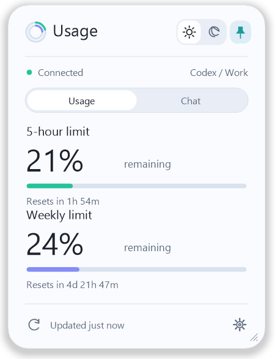
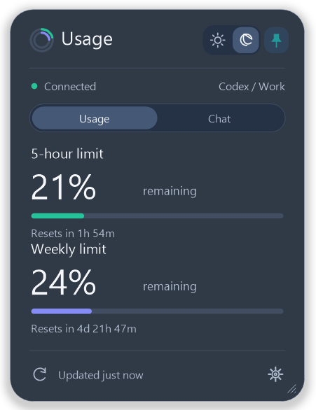
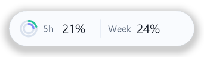
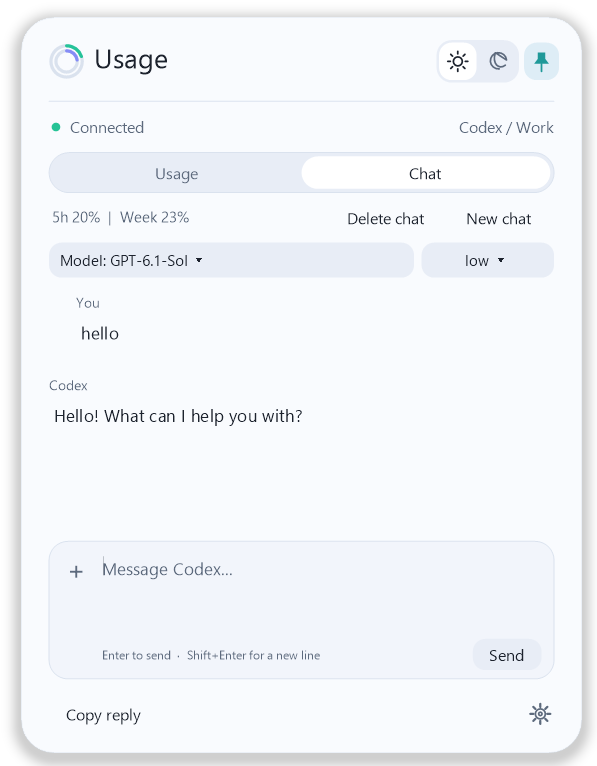
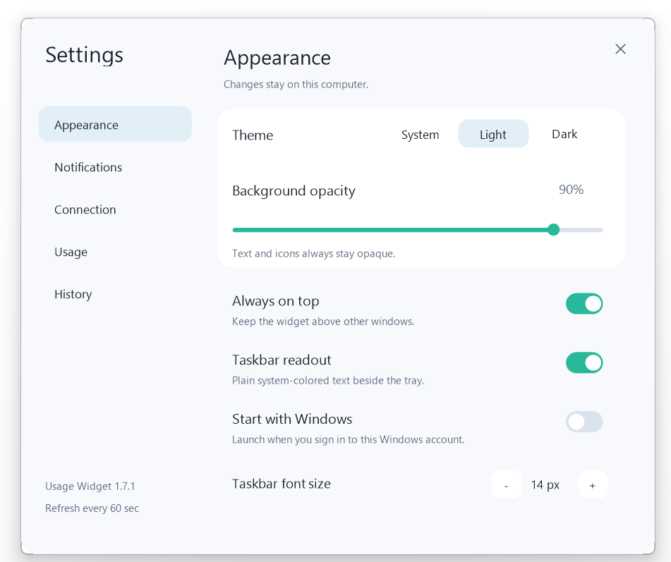
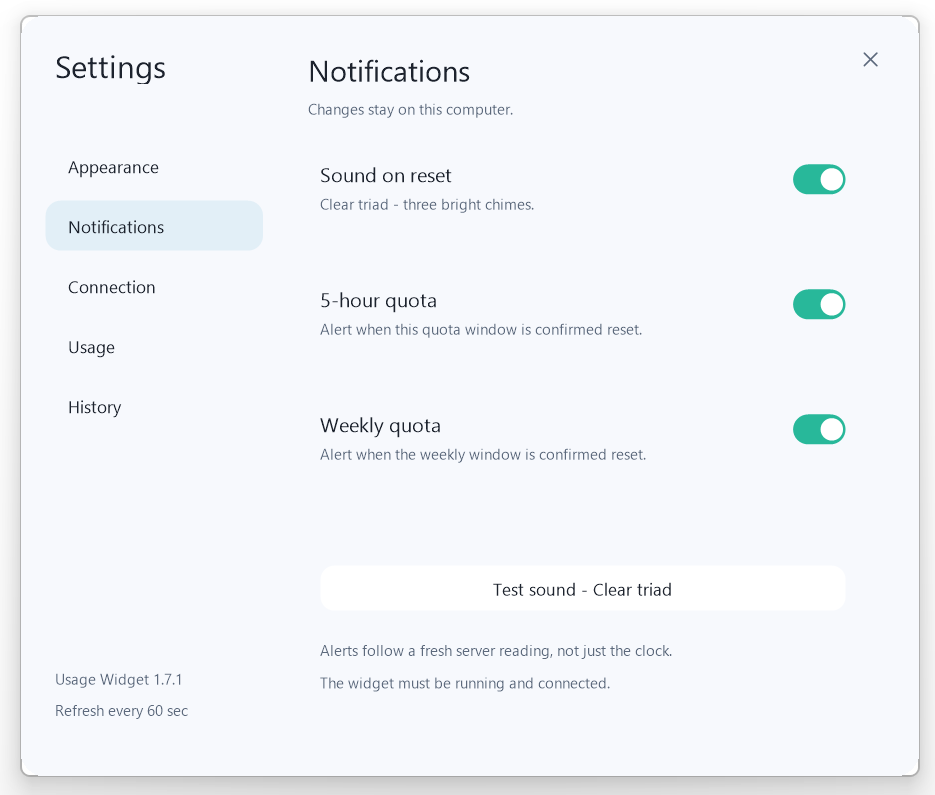
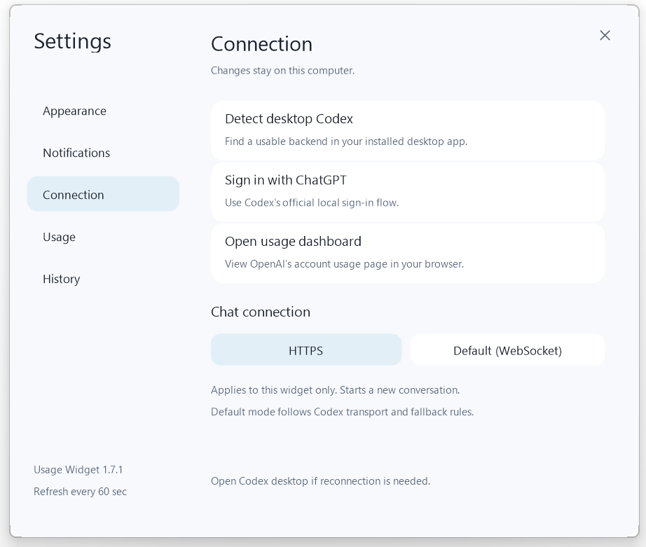
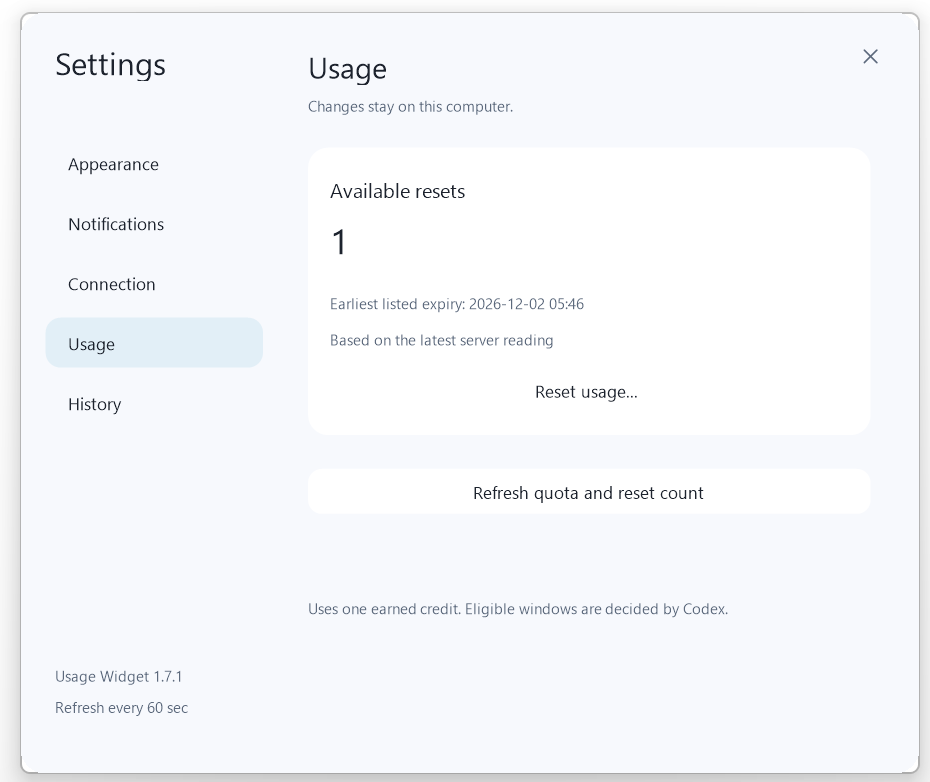
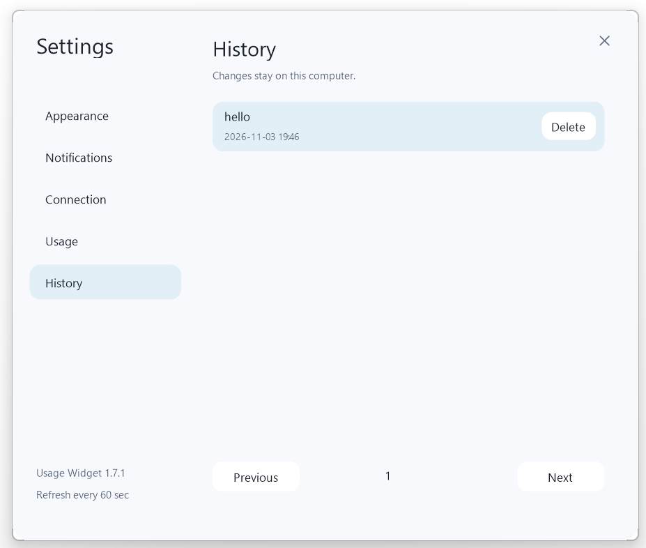

# Codex Usage Widget

### 额度，一眼即知。对话，随手即用。
### Your Codex limits at a glance. Quick chat within reach.

Windows 桌面悬浮小组件 · 轻量原生 C++ · 额度监测 · 重置提醒 · 快速对话  
A lightweight native C++ widget for Windows — usage tracking, reset alerts, and quick chat.

**[下载 / Download](https://github.com/Galaxy-NCC-1701-D/codex-usage-widget-windows/releases)** · **[安装 / Installation](#installation)** · **[截图 / Screenshots](#screenshots)** · **[反馈 / Issues](https://github.com/Galaxy-NCC-1701-D/codex-usage-widget-windows/issues)**

**[中文](#chinese)** · **[English](#english)**

&nbsp;&nbsp;

**小窗口，常用功能一步到位。**  
**A small window for the things you use every day.**

## 为什么使用它？

不用反复打开 Codex 查额度，也不用为了一个简单问题切换到完整客户端。把额度放在桌面上，重置时听到提醒，需要时直接开始对话。

| 优势 | 能帮你做什么 |
| --- | --- |
| **只有几 MB** | 原生 C++ Windows 程序。当前 v1.7.1 安装包约 **1.38 MB**，主程序约 **3.90 MB**，不包含另行安装的 Codex 后端。 |
| **额度一眼可见** | 查看 Codex **5 小时 / 每周剩余额度**、进度条和重置倒计时，也可以切换为胶囊或任务栏文字。 |
| **重置声音提醒** | 5 小时与每周额度分别设置提醒，支持试听；确认重置后播放轻快提示音。 |
| **随手快速对话** | 直接在悬浮窗提问，选择模型与推理强度，支持联网搜索、附件和文件输出。可用能力取决于 Codex 后端及账号。 |
| **贴合桌面** | 深浅主题、系统主题、背景透明度、置顶、拖动缩放，以及开机自动启动。 |

> 这是独立第三方项目，与 OpenAI 无隶属或官方合作关系。当前仍在持续完善；截图展示的是 v1.7.1，功能和界面可能随后更新。

## 功能预览 / Screenshots

### 01 · 额度面板 / Usage at a glance

上方的深浅主题截图展示了主面板：同时显示 5 小时与每周额度的**剩余百分比**、进度条、重置时间与连接状态。日常自动刷新约每 **60 秒**一次；手动刷新、聊天完成或后端更新也可能触发刷新。倒计时更新不代表重新读取了服务端额度。

The light and dark panels above show **remaining** 5-hour and weekly percentages, progress bars, reset countdowns, and connection status. Usage normally refreshes about every **60 seconds**, with additional refreshes on manual actions, completed chats, or backend updates.

### 02 · 更小的胶囊 / Compact capsule

双击标题区域或胶囊即可切换普通 / 胶囊模式。保留最重要的两个数字，减少桌面占用。任务栏读数还可以显示为 `5h … | Week …`，使用系统文字颜色，字号可调整，默认 14 px。

Double-click the header or capsule to switch modes. Keep just the two usage figures visible, or enable a plain system-colored taskbar readout. Taskbar text size is adjustable, with a 14 px default.

### 03 · 快速对话 / Quick chat

- **直接提问**：在 Usage / Chat 之间切换，支持 New chat、Stop 与复制回复。
- **模型选择**：使用后端提供的模型与推理强度选项。
- **日常搜索与处理**：支持实时联网搜索、主动上传的图片 / 文件，以及生成文件的下载入口。
- **便于阅读**：基础 Markdown 排版、可选择复制的文字、代码块，以及图片预览。
- **延续对话**：重启后恢复已保存对话，在设置中查看小组件历史。

Ask a question without leaving the widget. Choose an available model and reasoning level, search the web, attach images or files, copy selected text, and download generated outputs. Basic Markdown, code blocks, and image previews make replies easier to read. Saved conversations can be restored after restart.

**文件输出 / File outputs**：DOCX、PDF、PPTX、XLSX、RTF、PNG、JPG、BMP、TIFF，以及 TXT、Markdown、CSV、JSON、SVG 等文本格式。文档、幻灯片和表格支持基础内容与排版；PNG / JPG 等用于简单图形、文字和示意图，**不等同于 AI 绘画服务**。图片 / 文件的读取能力取决于格式及系统支持，PDF / Office 输入可能需要 Windows IFilter，扫描件不提供 OCR。文件生成不需要额外安装 Office 或 Python，但依赖可用字体、系统组件及后端正确调用工具。

Common outputs include DOCX, PDF, PPTX, XLSX, RTF, PNG, JPG, BMP, TIFF, and text formats such as TXT, Markdown, CSV, JSON, and SVG. Office files use basic layouts; raster outputs are for simple drawings and text, **not an AI art service**. Reading PDF / Office attachments may require a Windows IFilter; scanned pages have no OCR. Generation needs no separate Office or Python installation, but depends on fonts, system components, and backend tool support.

### 04 · 外观设置 / Make it yours

选择 System / Light / Dark；独立调节背景透明度，文字与图标保持清晰。开启置顶、任务栏读数或开机启动，并按桌面比例调整任务栏字号。

Choose System, Light, or Dark. Adjust background opacity while keeping text and icons opaque. Enable always-on-top, taskbar text, and startup with Windows, then tune the taskbar font size.

### 05 · 重置提醒 / Hear when your quota resets

内置 **Clear triad** 三音提示音，支持立即试听。5 小时与每周额度可分别启用提醒。提醒依据新的服务端数据确认重置，程序需要保持运行和连接，不会仅凭本地倒计时归零播放。

Preview the built-in **Clear triad** sound. Enable 5-hour and weekly alerts separately. Alerts require a fresh server-confirmed reset while the widget is running and connected.

### 06 · 连接管理 / Connection settings

自动检测已安装的桌面 Codex，使用 Codex 的 ChatGPT 登录流程，并可打开额度页面。聊天默认使用 **HTTPS / SSE**，也可切换为 **Default (WebSocket)**，由 Codex 使用其默认连接与回退策略。切换连接方式会开始一个新对话，已保存的历史保留。

Detect your installed desktop Codex, use its ChatGPT sign-in flow, and open the usage dashboard. Chat defaults to **HTTPS / SSE**. **Default (WebSocket)** uses Codex's normal transport and fallback behavior. Changing transport starts a new conversation and preserves saved history.

### 07 · 重置额度 / Available resets

如果账号与服务端提供此能力，显示可用重置次数、最早到期时间，并提供确认后的重置入口。**不能凭空增加额度或无限重置**；次数与适用窗口由 Codex 决定。截图中的 `1` 是当时的账号状态，不代表所有用户都有一次重置机会；未提供数据时显示不可用。

When supported by your account and backend, view available reset credits and their earliest expiry, then confirm a reset. **This cannot create credits or bypass limits.** Eligibility is decided by Codex. The `1` shown is an example account state, not a credit granted to every user.

### 08 · 对话历史 / Conversation history

在设置中查看、继续或删除小组件对话。删除需要确认；对应 Codex 会话删除成功后，再清理小组件中的本地记录和关联副本文件。你主动上传的原始文件不受影响。小组件对话不等于 ChatGPT 网页历史。

Browse, resume, or delete widget conversations in Settings. After confirmation and successful deletion of the matching Codex thread, the widget removes its local record and associated copied files. Your original uploaded files remain untouched. These conversations are separate from ChatGPT web history.

## 安装与首次使用

### 运行条件

- **Windows 10 / 11，x64**。
- 已安装兼容的 **Codex 桌面客户端或完整 Codex 后端**，并使用具备相应权限的 ChatGPT 账号登录。
- 可正常访问 Codex 服务的网络连接。

小组件本体只有几 MB，**不包含 Codex 后端**。仅在浏览器中登录 chatgpt.com，不能替代本项目所需的本地 Codex 后端。无需另行申请 API Key；当前接入使用 Codex 的 ChatGPT 登录，而非 API Key-only 账户。

### 安装步骤

1. 打开 **[Releases](https://github.com/Galaxy-NCC-1701-D/codex-usage-widget-windows/releases)**，进入已发布版本的 **Assets**。
2. 下载 `UsageWidget-Setup-<version>-x64.exe`，运行安装程序并按提示完成安装。若尚无 Release，请等待首个安装包发布；GitHub 自动生成的 **Source code** 压缩包是源码，不是安装程序。
3. 打开 Codex 桌面客户端并完成 ChatGPT 登录，然后启动 **Usage Widget**。
4. 点击小组件右下角齿轮，进入 **Connection**，选择 **Detect desktop Codex**。如尚未登录，使用 **Sign in with ChatGPT** 完成登录。
5. 主界面显示 **Connected** 后查看额度；切换 **Chat** 开始对话。
6. 在 **Appearance** 中选择主题、透明度和启动方式；在 **Notifications** 中试听并开启重置提示音。

### 常用操作

| 操作 | 方法 |
| --- | --- |
| 移动 / 调整大小 | 拖动标题区域 / 拖动窗口边缘 |
| 普通与胶囊模式切换 | 双击标题区域或胶囊 |
| 窗口置顶 | 点击右上角图钉，或在 Appearance 中设置 |
| 手动刷新额度 | 点击额度页左下角刷新图标 |
| 发送 / 换行 | `Enter` / `Shift + Enter` |
| 上传附件 | 点击输入框 `+`，或拖入文件 |
| 查看历史 | Settings → History |

### 常见问题

**显示的是 ChatGPT 全部用量吗？**  
不是。这里显示 Codex 后端提供的额度窗口，不代表 ChatGPT 网页所有模型的消息限额。百分比为**剩余**额度；`--` 表示数据不可用，`*` 表示数据可能过期。

**为什么连接不上？**  
先确认 Codex 桌面客户端本身能正常对话，再重新检测。后端需要同一安装目录下匹配的 `codex.exe` 与 `codex-code-mode-host.exe`。若使用代理，确认其覆盖小组件启动的后台进程；TUN 模式是否需要开启取决于你的代理配置。仍失败时，提交脱敏诊断信息，勿上传登录令牌。

**每台电脑都能使用截图里的模型与功能吗？**  
可选模型、搜索、重置权益及工具能力由账号、Codex 版本和服务端决定。导出格式已实现，但真实账号调用、系统字体 / 编解码器及 Windows 安装环境仍需进一步兼容性验证。

**数据保存在哪里？**  
设置、历史、附件副本和输出文件保存在 `%LOCALAPPDATA%\UsageWidget`，并非加密保险库。聊天及附件会交由 Codex 服务处理；Codex 也可能保存自己的记录。卸载默认保留本地用户数据，方便重装恢复。

## English

### Why this widget?

A small native Windows companion for keeping Codex usage visible and handling everyday questions. Check your limits without opening a full client, hear when they reset, and start a quick conversation from your desktop.

- **Small download:** the current v1.7.1 installer is approximately **1.38 MB**, with a **3.90 MB** application executable. The separately installed Codex backend is excluded.
- **Visible usage:** remaining 5-hour and weekly quotas, reset countdowns, compact capsule mode, and optional taskbar text.
- **Sound alerts:** separate switches for each quota window, with a built-in sound preview.
- **Quick chat:** backend-provided model and reasoning choices, live web search, attachments, basic Markdown, image previews, and downloadable files.
- **Desktop-friendly:** light / dark / system themes, background opacity, resizing, pinning, and optional Windows startup.
- **Saved conversations:** restore after restart, browse history, and confirm deletion of the matching Codex thread.

The bilingual [screenshot tour](#screenshots) above covers all nine supplied screenshots, including Appearance, Notifications, Connection, Usage resets, and History.

### Install

1. Use **Windows 10 / 11 x64**. Install a compatible Codex desktop app or complete local backend and sign in with a supported ChatGPT account.
2. Open **[Releases](https://github.com/Galaxy-NCC-1701-D/codex-usage-widget-windows/releases)** and download `UsageWidget-Setup-<version>-x64.exe` from a published release's **Assets**. If no release exists yet, an installer has not been published. The automatically generated **Source code** archives are not installers.
3. Run the installer, open Codex and sign in, then launch **Usage Widget**.
4. Go to **Settings → Connection → Detect desktop Codex**. Use **Sign in with ChatGPT** if needed.
5. Once **Connected**, check Usage or switch to Chat. Configure **Appearance** and **Notifications** to your preference.

A browser-only chatgpt.com login does **not** supply the local backend required by this project. An API key is not needed; API-key-only accounts are not the supported sign-in path.

### Notes

- Quotas come from Codex; they are not universal ChatGPT web message limits. Usage normally refreshes about every 60 seconds. `--` means unavailable; `*` indicates potentially stale data.
- Reset alerts require fresh server data while the widget is running and connected. Reset credits, models, web search, and tools depend on backend and account support.
- Default chat transport is HTTPS / SSE. The optional Default (WebSocket) setting follows Codex's normal transport and fallback rules.
- For connection problems, verify that Codex itself can chat and re-detect the installation. The backend and companion host must be a compatible pair from the same installation directory. Ensure any proxy also covers backend child processes.
- Settings, saved chats, copied attachments, and outputs are stored under `%LOCALAPPDATA%\UsageWidget`. Chat content and attachments are processed through Codex services. Local app data is not encrypted; uninstalling preserves it by default.
- This project is still being refined. Available exports have structural and build validation, but Windows runtime compatibility and live account tool invocation require further testing. It is an independent project, not affiliated with or endorsed by OpenAI.

## 反馈 / Feedback

欢迎通过 **[Issues](https://github.com/Galaxy-NCC-1701-D/codex-usage-widget-windows/issues)** 提交问题与建议。请提供版本、Windows 版本、复现步骤和必要截图；诊断信息应先脱敏，勿公开令牌、账号资料或私人对话。

Bug reports and suggestions are welcome in **[Issues](https://github.com/Galaxy-NCC-1701-D/codex-usage-widget-windows/issues)**. Include the app version, Windows version, reproduction steps, and relevant screenshots. Remove tokens, account details, and private conversations from diagnostics.

## 许可证 / License

[MIT License](LICENSE). OpenAI、ChatGPT 和 Codex 名称及相关商标归各自权利人所有。  
[MIT License](LICENSE). OpenAI, ChatGPT, Codex, and related trademarks belong to their respective owners.
